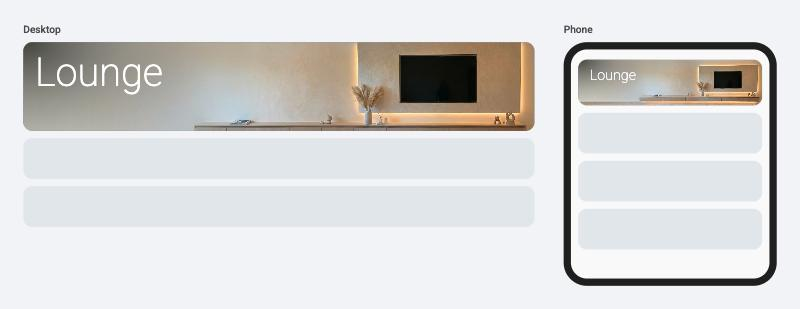
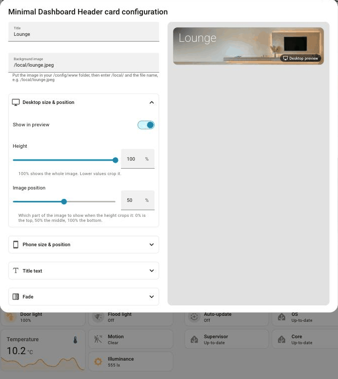
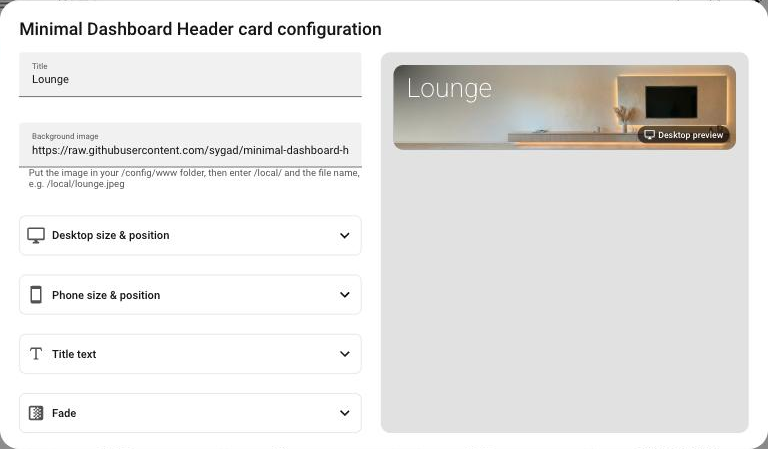
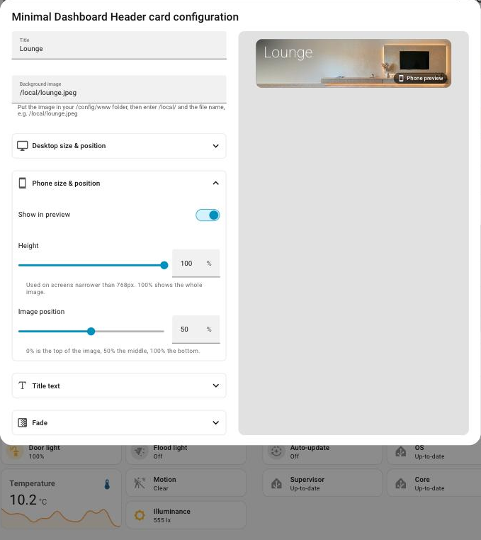

# Minimal Dashboard Header Card

A simple Home Assistant header card: a background image with a soft diagonal fade from the top left corner, and a title in the top left.



- Use your own background image
- Separate height and image position for desktop and phones
- Choose the title font, colour, weight and size
- Change the fade colour, strength and size
- Simple visual editor with a live desktop and phone preview, so you don't need to write YAML



## Installation (HACS)

1. In Home Assistant, open **HACS**.
2. Click the **⋮** menu (top right), then **Custom repositories**.
3. Paste `https://github.com/sygad/minimal-dashboard-header-card`, set **Type** to **Dashboard**, and click **Add**.
4. Search for **Minimal Dashboard Header Card**, open it, and click **Download**.
5. Refresh your browser.

## Adding your background image

Copy your image into the `www` folder in your Home Assistant config folder (create the folder if it isn't there yet). For example, `/config/www/lounge.jpeg` is then available at `/local/lounge.jpeg`.

A wide image works best, around 4:1 (for example 2064 × 512).

Want to try it out first? Download the [example lounge image](https://github.com/sygad/minimal-dashboard-header-card/raw/main/Images/Background%20image.jpeg), rename it to `lounge.jpeg` and copy it to `/config/www/`.

> If you've just created the `www` folder, restart Home Assistant once so it starts serving `/local/`.

## Adding the card

Edit a dashboard, click **Add card**, and search for **Minimal Dashboard Header Card**. Enter a **Title** and the **Background image** (e.g. `/local/lounge.jpeg`), and you're done. Everything else is optional.

### Using the editor



The other settings are grouped into sections you can open when you need them:

- **Desktop size & position**: how tall the card is, as a % of the image height (100% shows the whole image), and which part of the image to show when it's cropped (0% is the top, 100% the bottom).
- **Phone size & position**: the same settings for phones (screens narrower than 768px). They're separate from the desktop settings, so you can make the card taller on a phone, for example.
- **Title text**: font, colour, weight and size. See [Fonts](#fonts).
- **Fade**: the fade colour, how strong it is, and how far it reaches. **More fade options** has the colour it fades into.

The card always fills the width your dashboard layout gives it. The image, fade and title all scale with that width, so the card looks the same on any screen of the same type.

**Previewing desktop and phone:** each size section has a **Show in preview** switch. Turn it on in **Phone size & position** to see the phone version in the preview, and in **Desktop size & position** to go back. Only one can be on at a time, and the preview is labelled **Desktop preview** or **Phone preview** so you always know which one you're looking at.



## Layout tips

For the header to line up with the sections below it, put it in its own section with **no background** (edit the section, then turn off **Background**). Sections with a background add padding, which makes the card narrower than the sections below and adds extra space underneath it.

## Fonts

Pick a font in the editor under **Title text → Font**:

- **Theme font** uses your Home Assistant theme's font. Nothing is downloaded.
- **Roboto, Inter, Montserrat, Raleway, Poppins, Lato, Nunito, Open Sans, Oswald and Playfair Display** come from Google Fonts. They all have light weights, which suit a header.
- **Other Google font…** lets you type the name of any font on [fonts.google.com](https://fonts.google.com).
- **Custom font file…** uses a font file you put in your `/config/www` folder (`.woff2` or `.ttf`), e.g. `/local/fonts/myfont.woff2`.

Google fonts are downloaded by each device that shows the dashboard, so they need an internet connection, and the device contacts Google. If you'd rather avoid that, use **Theme font** or **Custom font file**. If a font can't be loaded, the card falls back to your theme's font. Not every font has every weight; the closest one is used.

## YAML

You don't need YAML, but if you prefer it:

```yaml
type: custom:minimal-dashboard-header-card
title: Lounge
image: /local/lounge.jpeg
height_percent: 70                # optional: desktop height
image_offset: 50                  # optional: desktop image position
height_percent_mobile: 100        # optional: phone height
image_offset_mobile: 50           # optional: phone image position
font_family: Roboto               # optional
text_color: [255, 255, 255]       # optional
fade_start_color: [0, 0, 0]       # optional
```

The editor only saves settings you've changed from the defaults, so your YAML stays short.

### Options

| Option                  | Default           | Description |
| ----------------------- | ----------------- | ----------- |
| `title`                 | `Lounge`          | The text in the top left corner |
| `image`                 | none              | Address of the background image, e.g. `/local/lounge.jpeg` |
| `height_percent`        | `100`             | Desktop card height, as a % of the image height. `100` shows the whole image; lower values crop it |
| `image_offset`          | `50`              | Desktop: which part of the image to show when it's cropped, from `0` (top) to `100` (bottom) |
| `height_percent_mobile` | `100`             | Phone card height (screens narrower than 768px), as a % of the image height |
| `image_offset_mobile`   | `50`              | Phone: which part of the image to show when it's cropped, from `0` (top) to `100` (bottom) |
| `font_family`           | `Roboto`          | Title font: `theme`, or the name of any font from [Google Fonts](https://fonts.google.com) |
| `font_url`              | none              | A font file you host yourself, e.g. `/local/fonts/myfont.woff2`. Used instead of `font_family` |
| `font_weight`           | `200`             | Title weight, from `100` (thin) to `900` (black). `200` is Extra light |
| `font_size`             | scales with card  | Title size in px. Leave it out to scale with the card width (recommended) |
| `text_color`            | `[255, 255, 255]` | Title colour, as `[r, g, b]` or any CSS colour (e.g. `"#fff"`) |
| `fade_start_color`      | `[0, 0, 0]`       | Fade colour in the top left corner |
| `fade_start_opacity`    | `70`              | Fade strength in the top left corner (0–100) |
| `fade_end_color`        | `[255, 255, 255]` | The colour the fade blends into |
| `fade_end_opacity`      | `0`               | Fade strength where it ends (0–100) |
| `fade_width`            | `52`              | How far the fade reaches to the right, as a % of the card width |
| `fade_height`           | `132`             | How far the fade reaches down, as a % of the image height |

With the default fade size, the fade ends at the middle of the card along the diagonal.

## Theme variables (optional)

| Variable                      | Default |
| ----------------------------- | ------- |
| `mdc-header-card-background`  | `#01152f` (shown while the image loads, or if there's no image) |
| `mdc-header-card-radius`      | your theme's card radius (`12px` if not set) |
| `mdc-header-title-margin`     | `0` |
| `mdc-header-title-padding`    | `max(2cqw, 12px) max(2.1cqw, 16px)` (scales with the card, never smaller than 12px / 16px) |

## Upgrading from an older version

- **v0.2.0** used `height` in pixels and `image_position: top / center / bottom`. `height` is no longer used: set **Height** in the editor instead. `image_position` still works, and the editor turns it into the new **Image position** slider when you next save.
- **Before v0.4.0**, phones used the desktop height. Phones now have their own settings, starting at 100% height. Set them in **Phone size & position**.
